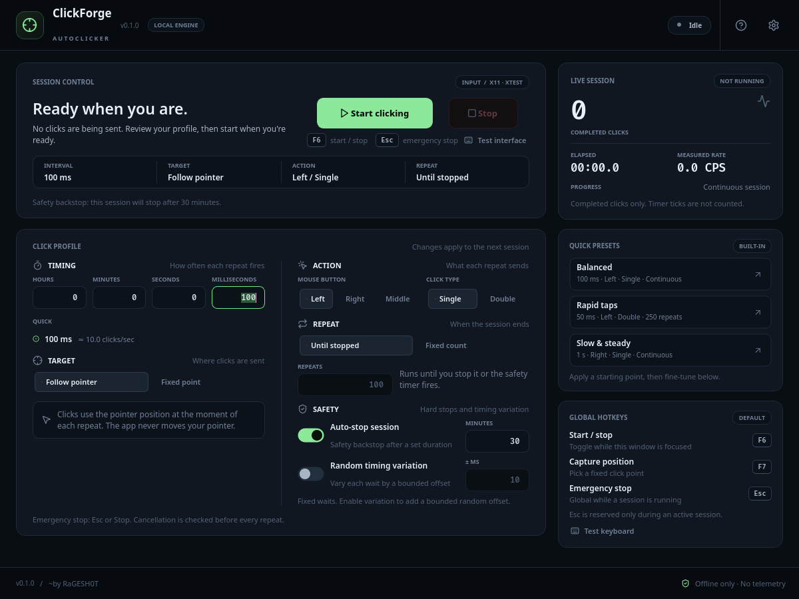
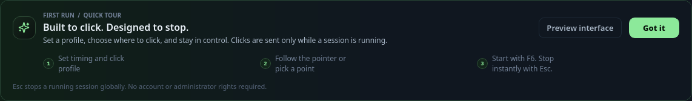
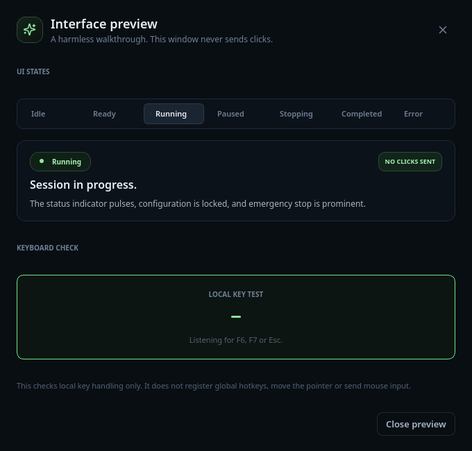
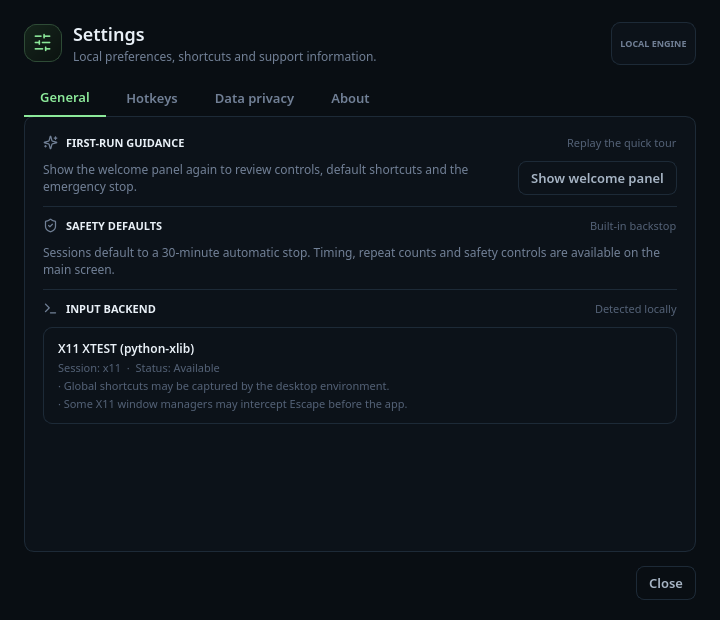

# ClickForge

A safety-first desktop autoclicker for Windows and Linux X11.



ClickForge is a local-only desktop utility for repeating mouse clicks at a
chosen interval. It is built for predictable behavior: one session at a time,
an emergency stop that works from anywhere, a configurable session limit, and a
live position picker that does not freeze the desktop.

> **Status:** `0.1.0` alpha. Linux X11 and Windows 10/11 builds are available and
> have been tested on real hardware. Windows binaries are currently unsigned.
> Wayland is not supported.

## Contents

- [Features](#features)
- [Platform support](#platform-support)
- [Download and install](#download-and-install)
- [Quick start](#quick-start)
- [Using ClickForge](#using-clickforge)
- [Hotkeys](#hotkeys)
- [Presets](#presets)
- [Settings](#settings)
- [Data and privacy](#data-and-privacy)
- [Troubleshooting](#troubleshooting)
- [Building from source](#building-from-source)
- [Project structure](#project-structure)
- [How it works](#how-it-works)
- [Testing and development](#testing-and-development)
- [Limitations and roadmap](#limitations-and-roadmap)
- [Credits](#credits)
- [License](#license)

## Features

**Clicking**

- Intervals from 1 ms up to 23:59:59.999.
- Optional random timing variation (jitter) of up to ±60 seconds.
- Left, middle or right mouse button.
- Single or double clicks.
- Continuous clicking or a fixed repeat count from 1 to 1,000,000.
- Follow the pointer, or click a fixed screen coordinate.
- Live counters for completed clicks, elapsed time and measured click rate.

**Safety**

- Session auto-stop enabled by default at 30 minutes, adjustable from 1 minute
  to 24 hours, and can be turned off.
- Global `Esc` emergency stop while a session is running.
- Cancellation is checked before every repeat, and long waits are interruptible.
- Click settings and presets are locked during a session.
- Only one click session can run at a time.
- No administrator or root rights required.

**Interface**

- First-run welcome panel with a short guide and a safe interface preview.
- Three built-in presets.
- Full-desktop position picker that keeps the desktop live.
- Responsive layout with a compact mode; the window can shrink to 820x560.
- Clear session states: idle, ready, running, stopping, completed and error.

**Privacy**

- No account, telemetry, ads, network requests or bundled offers.
- Mouse coordinates, keystrokes and session contents are never recorded.
- Optional diagnostic report is redacted before it is copied to the clipboard.

## Platform support

| Platform | Status | Input method |
| --- | --- | --- |
| Linux X11 | Supported and tested | XTEST through `python-xlib` |
| Windows 10/11 (64-bit) | Supported and tested | `SendInput` and low-level hooks |
| Wayland | Not supported | Pointer injection and global key grabs are blocked by design |
| macOS | Not available | - |

On Linux, use an X11 session. XWayland is not sufficient: it does not reliably
allow global pointer injection or global hotkey grabs, so ClickForge reports the
backend as unavailable instead of silently failing.

### Requirements

- Linux with an X11 desktop session, or Windows 10/11 (64-bit).
- No administrator or root privileges.
- Python 3.10 or newer only when running from source. Release builds bundle
  Python and Qt.

## Download and install

Published binaries are attached to the project's GitHub Releases page. Every
archive has a matching `.sha256` checksum file. Current release artifacts:

| Artifact | Purpose |
| --- | --- |
| `ClickForge-0.1.0-windows-x86_64-setup.exe` | Per-user Windows installer |
| `ClickForge-0.1.0-windows-x86_64.zip` | Portable Windows executable |
| `ClickForge-0.1.0-linux-x86_64.tar.gz` | Portable Linux application and install script |
| `clickforge_0.1.0_amd64.deb` | Debian/Ubuntu package |

### Windows installer

1. Run `ClickForge-0.1.0-windows-x86_64-setup.exe`.
2. Windows SmartScreen may warn because the build is unsigned. Use **More info**
   -> **Run anyway** after verifying the checksum below.
3. The installer is per-user and does not request administrator rights. It
   installs to `%LOCALAPPDATA%\Programs\ClickForge`, adds Start Menu shortcuts
   and offers an optional desktop shortcut.
4. Uninstall from **Settings -> Apps -> Installed apps -> ClickForge**, or run
   `Uninstall.exe` from the install folder. User settings and logs are left in
   `%LOCALAPPDATA%\ClickForge\clickforge`.

### Windows portable

Extract `ClickForge-0.1.0-windows-x86_64.zip` anywhere and run
`ClickForge.exe`. Nothing is installed and no Python runtime is required. The
portable build still stores settings and logs in the standard per-user
locations listed in [Data and privacy](#data-and-privacy).

### Linux tarball

The Linux archive is a one-folder PyInstaller bundle. Keep the `_internal/`
directory next to the `ClickForge` executable.

```bash
tar -xzf ClickForge-0.1.0-linux-x86_64.tar.gz
cd ClickForge-0.1.0-linux-x86_64
./ClickForge
```

To install for the current user only:

```bash
./install.sh
clickforge
```

`install.sh` copies the application to `${XDG_DATA_HOME:-~/.local/share}/clickforge`,
creates a `clickforge` command in `${XDG_BIN_HOME:-~/.local/bin}`, and adds an
application-menu entry and icon. If `~/.local/bin` is not on your `PATH`, run
`~/.local/bin/clickforge` or add the directory to `PATH`.

Uninstall with `./uninstall.sh` from the extracted folder. The launcher, menu
entry and installed files are removed; user settings and logs are left in place.
No system Python or Qt installation is needed.

### Debian and Ubuntu

The `.deb` package installs the application under `/opt/clickforge`, adds a
`clickforge` command to `/usr/bin`, and registers a menu entry and icon:

```bash
sudo apt install ./clickforge_0.1.0_amd64.deb
clickforge
```

Installing with `apt` resolves the runtime dependencies. If you use
`sudo dpkg -i clickforge_0.1.0_amd64.deb` instead, follow it with
`sudo apt-get install -f` to install any missing dependencies.

Remove it with `sudo apt remove clickforge`. As with the tarball, user settings
and logs are left in place. The package declares the glibc version used by its
build host, so it may not install on older distributions; use the tarball or
build from source there.

### Verifying downloads

Linux:

```bash
sha256sum -c ClickForge-0.1.0-linux-x86_64.tar.gz.sha256
sha256sum -c clickforge_0.1.0_amd64.deb.sha256
```

Windows (PowerShell):

```powershell
Get-FileHash .\ClickForge-0.1.0-windows-x86_64-setup.exe -Algorithm SHA256
```

Compare the output with the value in the matching `.sha256` file. Release
artifacts are not committed to git; they are attached to GitHub Releases.

## Quick start

1. Launch ClickForge. On first run, the welcome panel explains the controls.
2. Choose a preset, or set the interval and click action yourself.
3. Keep **Follow pointer**, or choose **Fixed point** and press **Pick on screen**
   (`F7`). Click the target location; right-click or `Esc` cancels.
4. Choose continuous clicking or a fixed repeat count. Leave the safety limit on.
5. Press **Start clicking** or `F6`.
6. Stop with **Stop**, `F6`, or the global `Esc` shortcut.

Use **Test interface** (or **Preview interface** in the welcome panel) to explore
the session states and test local key handling. The preview never registers
global hotkeys and never sends mouse input.

## Using ClickForge

### Timing

The interval is the delay between repeats. The first repeat starts immediately.
The interval fields accept hours, minutes, seconds and milliseconds; the quick
buttons set 50, 100, 250 or 500 ms.

When jitter is enabled, each delay is chosen uniformly from
`interval ± jitter` and clamped to the valid range. Jitter is disabled by
default and can be set up to 60,000 ms.

For a double click, the pair is sent back-to-back; the interval applies between
one repeat and the next, not between the two clicks of a pair.

### Click action

Choose the left, middle or right mouse button and **Single** or **Double**. A
double click counts as two completed clicks and one repeat in the session
statistics.

At very short intervals, some applications and desktops coalesce or drop input
events. The measured click rate shown during a session reflects the clicks
ClickForge actually completed.

### Target modes

**Follow pointer** clicks at the pointer position at the moment of each repeat.
ClickForge does not move the pointer in this mode.

**Fixed point** sends every click to a chosen desktop coordinate. Use
**Pick on screen** (`F7`) to capture it. On Linux X11 and Windows the picker is
native: it waits for your next click without taking a screenshot or covering
the desktop. The captured left click is consumed by the picker. Right-click or
`Esc` cancels. A dimmed snapshot fallback is used only when no native picker is
available.

Coordinates are global desktop coordinates, so negative values are valid on
multi-monitor layouts. Re-pick the point after changing display arrangement or
scaling. In fixed-point mode the pointer is moved to the target for each click.

### Repeats

- **Until stopped** keeps clicking until you stop the session or the safety
  limit is reached.
- **Fixed count** stops after between 1 and 1,000,000 repeats.

### Safety limit

The session auto-stop is enabled by default at 30 minutes and can be set from 1
minute to 24 hours. When the limit is reached, the session completes normally
and reports the reason. Click settings and presets are locked while a session is
running or stopping, so input behavior cannot change mid-session.

### Session states

The session panel reports states such as idle, ready, running, stopping,
completed and error with a short reason. **Test interface** lets you preview
those states safely, along with a local keyboard check for `F6`, `F7` and `Esc`.

## Hotkeys

| Shortcut | Scope | Action |
| --- | --- | --- |
| `F1` | Focused window | Show the welcome panel |
| `Ctrl+,` | Focused window | Open Settings |
| `F6` | Focused window | Start or stop a session |
| `F7` | Focused window | Pick a fixed point with the position picker |
| `Esc` | Global while running | Emergency stop |

`Esc` is captured globally only while a session is active, so it remains usable
in every other application when ClickForge is idle. Global `Esc` requires a
successful key grab. If another program owns the key, ClickForge logs a warning;
the local `Esc` shortcut and the **Stop** button still work.

On Linux, global hotkeys require an X11 session. On Windows they are registered
only for the lifetime of the session.

## Presets

| Preset | Interval | Button | Click | Repeat |
| --- | --- | --- | --- | --- |
| Balanced | 100 ms | Left | Single | Continuous |
| Rapid taps | 50 ms | Left | Double | 250 repeats (500 clicks) |
| Slow & steady | 1 s | Right | Single | Continuous |

Presets fill in the configuration controls; you can adjust any value afterwards.
Preset and configuration controls are locked while a session runs.

## Settings

Open Settings with the gear button or `Ctrl+,`. The dialog has four tabs:

- **General** - replay the welcome panel and inspect the detected input backend.
- **Hotkeys** - reference the default shortcuts and run a local keyboard test.
- **Data privacy** - open the configuration and log folders, and copy a redacted
  diagnostic report.
- **About** - version, author line and license.







## Data and privacy

ClickForge works entirely offline. It does not create an account, contact a
server, send telemetry or bundle third-party offers.

### Local files

| What | Linux | Windows |
| --- | --- | --- |
| Configuration | `~/.config/clickforge/` | `%LOCALAPPDATA%\ClickForge\clickforge\` |
| Logs | `~/.local/state/clickforge/log/` | `%LOCALAPPDATA%\ClickForge\clickforge\Logs\` |

Linux paths respect `XDG_CONFIG_HOME` and `XDG_STATE_HOME`. The configuration
file is `ui-state.json`; it currently stores only whether the welcome panel has
been seen. The log file is `clickforge.log`, rotated at 512 KB with two backups.

Two environment variables override the locations, which is useful for portable
setups and automated tests:

```bash
CLICKFORGE_CONFIG_DIR=/path/to/config
CLICKFORGE_LOG_DIR=/path/to/logs
```

### Diagnostics

**Settings -> Data privacy -> Copy diagnostic report** creates a plain-text
report with the app version, operating system, Qt version, input backend status
and local data paths. Your home directory is redacted. The report never includes
clicks, coordinates, keystrokes, screenshots or application contents.

There is no session history: ClickForge does not save completed sessions or
individual click events.

## Troubleshooting

**Wayland / "Input backend unavailable"**

ClickForge requires an X11 session on Linux. Check `echo $XDG_SESSION_TYPE` and
log out and back in choosing an X11 session. XWayland does not provide reliable
global pointer injection or key grabs. The detected backend and any reason are
shown in **Settings -> General** and in the startup log.

**Global `Esc` does not stop the session**

Another application or the desktop environment may already own the `Esc` grab.
ClickForge logs a warning when the global grab fails. Use the window's **Stop**
button or the local `Esc`/`F6` shortcuts instead. Elevated Windows applications
may also block input and hotkeys from a non-elevated process.

**A single click is interpreted as a double click**

**Single** mode sends one click per repeat. If the interval is shorter than the
receiving application's double-click threshold (often 400-500 ms), consecutive
single clicks can be grouped into a double click. Increase the interval, or use
a fixed count of 1 for a one-off click. Use **Double** only when you actually
want double clicks.

**Fixed-point clicks land in the wrong place**

Coordinates are global desktop coordinates. Re-pick the point after changing
monitor arrangement, resolution or scaling. Negative coordinates are valid for
monitors positioned left of or above the primary display.

**Clicks are ignored by an elevated Windows application**

Windows blocks a lower-integrity process from sending input to a
higher-integrity one. ClickForge intentionally does not request elevation. If
you need this, start both applications at the same integrity level; running as
administrator is your choice and is not required for normal use.

**Windows SmartScreen warning**

The Windows builds are unsigned. Verify the SHA-256 checksum, then use **More
info -> Run anyway**. Building from source and signing the executable yourself
is also possible; see [Building from source](#building-from-source).

**The Linux build does not start**

Make sure `ClickForge` is executable (`chmod +x ClickForge`) and that the
`_internal/` folder is next to it. Do not move the executable out of its
extracted folder. Release binaries are built on a current Linux runner; on an
older distribution, run from source instead.

**The .deb will not install because of a `libc6` dependency**

The package records the glibc version of its build host. On an older
distribution, use the portable tarball or run from source instead.

**Reset the first-run state**

Delete `ui-state.json` from the configuration folder (or set
`CLICKFORGE_CONFIG_DIR` to a temporary directory). This only resets UI state; it
does not affect logs.

**Reporting a bug**

Run with `--verbose`, reproduce the issue, then copy the diagnostic report from
Settings and include the relevant log lines. The report and logs are local files;
review them before sharing. Do not include session screenshots or coordinates
unless they are needed to explain the problem.

## Building from source

### Development setup

```bash
git clone <repository-url> ClickForge
cd ClickForge
python -m venv .venv
source .venv/bin/activate
pip install -e ".[dev]"
```

On Windows, activate with `.venv\Scripts\activate`.

Run the app:

```bash
clickforge
# or
python -m clickforge
```

Launch options:

```bash
clickforge --show-welcome   # show the first-run panel again
clickforge --skip-welcome   # hide the welcome panel for this launch
clickforge --verbose        # debug logging
clickforge --version
```

### Linux bundle and tarball

```bash
source .venv/bin/activate
python scripts/build.py          # one-folder bundle in packaging/dist/ClickForge/
python scripts/package_linux.py  # tarball and checksum in packaging/release/
```

`package_linux.py` builds the PyInstaller bundle, copies `START-HERE.txt`,
`README.md`, `LICENSE` and the install scripts into a staging folder, then writes
`ClickForge-<version>-linux-<arch>.tar.gz` and a `.sha256` file. PyInstaller does
not cross-compile, so build on the target operating system.

### Debian package

```bash
source .venv/bin/activate
python scripts/package_deb.py
```

This builds the bundle, stages a Debian package tree, and writes
`packaging/release/clickforge_<version>_<arch>.deb` plus a `.sha256` file. It
requires `dpkg-deb`; `readelf` from binutils is used to determine the minimum
`libc6` version. The package installs to `/opt/clickforge`, with a symlink in
`/usr/bin`, a desktop entry and a scalable icon. User settings and logs live
outside the package and survive removal.

### Windows executable and installer

The Windows build uses PyInstaller and NSIS. Build on Windows (the included
GitHub Actions workflow does this automatically):

```powershell
python -m pip install "PySide6==6.8.3" -e ".[dev]"
python -m PyInstaller --noconfirm --clean `
  --distpath packaging/dist-windows --workpath packaging/build-windows `
  packaging/clickforge-windows.spec
makensis packaging/windows/installer.nsi
```

This produces `packaging/dist-windows/ClickForge.exe` and the per-user installer
`packaging/release/ClickForge-<version>-windows-x86_64-setup.exe`. The NSIS
script installs under `%LOCALAPPDATA%\Programs\ClickForge`, creates Start Menu
shortcuts and an optional desktop shortcut, and registers an uninstaller in
Windows Settings. The workflow also creates a portable zip.

PySide6 6.8.3 is pinned for the Windows build because newer Qt wheels expect an
`icuuc.dll` runtime that is not present on all systems.

The release workflow runs the test suite, builds the executable, the installer
and the portable zip, and publishes them with SHA-256 checksums. Windows builds
are not code-signed yet; SmartScreen may warn. If signing is added later, sign
`ClickForge.exe` before the installer is built, sign the installer, timestamp
both, then regenerate the checksums.

## Project structure

```text
src/clickforge/
  app.py                    application entry point and CLI
  core/
    engine.py               threaded, cancellable click session engine
    models.py               profiles, enums, limits and defaults
    validation.py           profile validation shared by UI and engine
    formatting.py           interval and duration formatting
  backends/
    x11.py                  XTEST click backend
    windows.py              SendInput click backend
    capabilities.py         backend detection and diagnostics
    pointer_picker.py       live X11 and Windows position pickers
    hotkeys.py              global emergency-stop listeners
    base.py                 backend protocol and errors
  services/
    paths.py                platform-standard config and log locations
    logging_setup.py        rotating file logging
    first_run.py            small atomic UI-state store
    presets.py              built-in presets
    diagnostics.py          redacted support report
    session_controller.py   UI/engine coordination
  ui/
    main_window.py          main screen and keyboard shortcuts
    theme.py                Qt stylesheet and palette
    widgets/                configuration, session, stats, welcome, hotkeys
    dialogs/                position picker, settings, interface preview
  resources/                icons, app icon and third-party notices
tests/                      unit and UI tests with fake backends
packaging/
  clickforge.spec           Linux PyInstaller spec
  clickforge-windows.spec   Windows one-file PyInstaller spec
  linux/                    install.sh and uninstall.sh
  windows/                  installer.nsi and START-HERE.txt
scripts/                    build, Linux tarball/.deb packaging and screenshot helpers
.github/workflows/          Windows build and release workflow
```

## How it works

ClickForge separates input logic from the UI so the scheduling behavior is easy
to test without sending real clicks:

```text
Qt widgets -> SessionController -> ClickEngine (worker thread) -> InputBackend
                    |                     |
                    +---- snapshots ------+
```

- The Qt UI only edits a validated `ClickProfile` and displays engine snapshots.
- `ClickEngine` runs one session at a time on a background thread. It checks for
  stop requests before each repeat, uses interruptible waits between repeats, and
  enforces the fixed repeat count and the session time limit.
- Backends are intentionally small: X11 uses XTEST, Windows uses `SendInput`.
  Backend resolution happens when a session starts, and failures are reported as
  session errors instead of crashing the app.
- The live picker runs independently of the click engine. The X11 picker grabs
  the pointer and `Esc` key; the Windows picker uses low-level hooks. Both return
  global desktop coordinates and swallow the captured click.
- Global emergency stop is installed only for the duration of a session.

## Testing and development

```bash
source .venv/bin/activate
python -m pytest -q
ruff check .
ruff format --check .
```

The test suite runs Qt with the offscreen platform and injects fake input
backends and clocks, so it never sends real clicks and does not depend on a
display server. Tests cover validation, timing, cancellation, session limits,
backend selection, window state, layout behavior and the picker plumbing.

Regenerate documentation screenshots:

```bash
python scripts/capture_screenshots.py
```

The Windows workflow runs the same tests before building release artifacts.

## Limitations and roadmap

- **Wayland:** unsupported. Safe global input injection and hotkey grabs are not
  available through a reliable cross-desktop mechanism yet.
- **macOS:** not available.
- **Windows signing:** builds are unsigned, so SmartScreen warnings are expected.
- **Shortcut remapping:** not implemented; `F1`, `Ctrl+,`, `F6`, `F7` and `Esc`
  are fixed.
- **Settings persistence:** the only saved UI preference is whether the welcome
  panel has been seen. Click profiles are not saved between launches.
- **One session:** only one click session can run at a time.
- **Release architectures:** published Linux tarballs are built for x86_64;
  Windows artifacts are 64-bit. Other architectures can run from source.
- **Session history:** intentionally not stored.

Possible future work includes code signing, saved profiles, remappable shortcuts
and a safe portal-based approach for Wayland if one becomes practical.

## Credits

Created by RaGESH0T.

ClickForge is built with Qt for Python (PySide6), `python-xlib`, `platformdirs`
and PyInstaller. Windows installers are built with NSIS. Interface icons come
from Lucide and are used under the ISC license; see
`src/clickforge/resources/icons/LICENSE-lucide.txt`.

## License

MIT. See [LICENSE](LICENSE). Third-party dependencies retain their own licenses.
